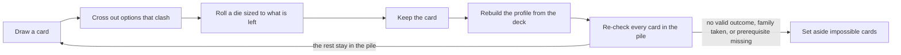

# Phonology Challenge: card expansion plan

As of 2026-11-04 (Phase 7 done; every phase is built). Editable copy: [Claude Doc](https://claude.ai/artifact/6R1fk5PSq4ZNwtJ4TxJ9CR). This file is the repo snapshot of that doc; if they differ, ask which one is current.

## Where things stand

- **Built:** the roller in `phonology-challenge.html`, with all 57 hand-made cards (now 60 after the Phase 1 split), the parser (`[dN]`, `A+[dN]`, `[dN*K]`, lists, coin flips, `(If x: …)`), dice physics, the deck, and account or browser saving.
- **Phase 4, done:** 12 phoneme mandate cards, the `[ipa:…]` pool syntax (feature terms joined with `+`), the bundled PHOIBLE 2.0 table (871 segments), a dealt hand of up to 20, and the phoneme name on the card. Since Phase 3, hands are dealt only from phonemes that fit the profile, and a kept phoneme writes its features back (see "Phase 3 as built").
- **Phase 1, done:** the fixes table is applied to the card list (the Include special feature tags followed in Phase 2). Rows take an optional last column of `key=value` tags; only `family=` is read so far. The 3 consonant count cards and the 3 vowel count cards are families: keeping one sets the others aside (a count shows under the pile), and they return when it leaves the deck. Saved piles, decks and cards in play from the old list carry over.
- **Phase 7, done:** curse and power-up cards, built as decided. Settled 2026-11-04: Phase 6 modifiers merge into power-ups (tokens you spend when you choose), curses never make the language easier, cursed cards stay cursed, the names stay, power-ups and curses come in several copies (fewer for stronger ones), the game layer is a setting, curses stack, you hold at most 3 tokens, the curse counter counts kept cards, and discarding a curse costs a Discard token. See "Curses and power-ups" for the decisions and "Phase 7 as built" for what was built and the small details the user still has to confirm.
- **Phase 2, done:** `@name` rows define named lists, and cards use them as `[@name]`. The built-in cards now use `@place`, `@manner`, `@vheight`, `@vback`, `@special` and `@vfeature`, with no change to any card's wording or dice. Options can carry a `{type}` mark; `@special` uses it for the Include special fix. The parser reads and checks `needs`, `effect` (one of the six values below) and `counts`, but only `family` changes play. `needs` and `counts` take any value until Phase 3 settles their vocabulary. The Edit cards preview lists each named list (options, types, how many cards use it) and each card's tags, with unknown tags, effects, lists and types flagged. Kept cards now store `entry.rolled` (each roll's value, list and type) for the profile to read; cards kept before this only have their text.
- **Phase 3, done:** every built-in card that writes to the language now carries `effect`, `counts`, `feature` or `needs` tags. The profile is rebuilt from the deck on every change and shown in a panel beside the deck. Clashing options are struck through and the die shrinks to what's left, a slot with one value left is set without a roll (with the reason on the card), and the pile sets aside cards whose family is taken, whose `needs` is missing, or that have no roll that fits. The set-aside list, with a reason for each card, is in the profile panel. Details and the interpretations behind the checks are in "Phase 3 as built".
- **Phase 5, done:** 21 new cards (93 in all): two gap cards, templates for syllable size, codas and hiatus, four tone cards, rule-interaction and morphology cards, and cards for each coverage gap. Extrametricality now waits for a foot-based stress system. The new card wording is a first draft for the user to reword. Details and the new interpretations are in "Phase 5 as built".
- **Phase 6, done:** 3 modifier cards (96 in all): Re-roll, Flip and Free pick, marked with a new `modifier=` tag. Re-roll and Flip change a kept card, checked against the deck without it, and save over the old entry with a note of what it said before. Free pick gives a token for choosing the next option yourself. Consonant harmony now has a `[do/don't]`. Details and the interpretations behind them are in "Phase 6 as built".
- **Next step:** the user plays the game layer and checks the interpretations under "Phase 7 as built", then tunes `copies=` and the curse wording in Edit cards. The interpretations under "Phase 3 as built", "Phase 5 as built" and "Phase 6 as built" still need the user's check too. Nothing else is planned; see "Open questions" and "More ideas".

## Summary

The roller gets a **language profile**: a running record of what your kept cards have committed the language to. The profile does three jobs. It removes impossible cards from the pile, it crosses out options that would contradict earlier cards, and it makes phoneme cards possible.

Around that core, the plan adds six new card types, fills coverage gaps in the current 57 cards, and fixes cards whose wording or dice don't work. Work is split into seven phases, and the first one needs no profile at all.

## Decisions made

**Clashing options are crossed out, and the die rolls only what's left.** Before a roll, every option that contradicts the profile is struck through on the option strip. The remaining options are renumbered, and the tray offers a die with that many sides. For example, a d12 place roll with 3 places ruled out becomes a d9 over the 9 places still open.

- **Number rolls** shrink the same way. If the inventory budget leaves room for only 6 more rare phonemes, a d10 rolls as a d6.
- **Coin flips** with one side crossed out are decided without a flip. The card shows the forced result and why.
- **A slot with nothing left** can't happen in play, because the pile filter (below) sets such cards aside before they can be drawn.

**Clashes filter the pile.** After every keep, the tool re-checks each card in the pile. A card leaves the pile when no outcome of it fits the profile, when a card from its family is already in the deck, or when its prerequisite is missing. Set-aside cards stay visible in a small "set aside" list with the reason for each, and they return automatically if you remove the card that blocked them.

## The language profile

The profile is rebuilt from the deck every time the deck changes, so removing a kept card also removes the facts it added. Each card writes to one or more areas:

| Area | What it records | Written by (examples) |
| --- | --- | --- |
| Inventory size | Consonant and vowel count ranges, diphthong count, open cells | Consonant Count Small/Medium/Large, Vowel Count, Diphthong Count, Open cells |
| Places | Included, excluded, neutralized, symmetrical; minor and major place totals | Include place, Place neutralization, Place limitations, Total minor/major places |
| Manners | Included, excluded, neutralized, symmetrical | Include manner, Manner neutralization, Manner limitations |
| Special series | Airstream (ejective, implosive, click), laryngeal (aspirated, breathy), secondary articulation, prenasalization | Include special, Special limitations |
| Vowel space | Heights, backness and rounding included or excluded | Include vowel position, Vowel position limitation and symmetry |
| Vowel features | Nasality, phonation, length, tone | Include vowel feature, Total vowel features |
| Prosody | Quantity yes or no, tone yes or no, stress system, foot type and direction, pitch accent | Quantity distinction, Pitch accent, Foot type, Quantity sensitivity |
| Syllables | Moras per syllable, structure limits | Mora per syllable, Syllable/Foot/Word limitations |
| Mandated phonemes | Each phoneme with its full feature set | New phoneme cards |
| Phoneme budget | How many phonemes are already spoken for by frequency band | Common, Uncommon and Rare phonemes cards |

Four kinds of clash are checked against these areas:

1. **Contradiction.** One card includes something another excludes. Example: "Don't include velar" against "neutralization of velar".
2. **Budget.** Required phonemes exceed the inventory size. Example: 15 rare plus 20 common phonemes in a 5+d15 consonant inventory.
3. **Dependency.** A card needs something that isn't there. Example: tone sandhi without tone, or quantity sensitivity after "Don't include any sort of quantity distinction".
4. **Family.** Only one card per family. Example: one consonant count card per set.



The profile is checked twice: once on the whole pile after each keep, and again on each slot just before its roll.

## Phoneme mandate cards

These cards require specific phonemes, such as "Include a rare phoneme" or "Include a co-articulated stop". Each phoneme is classified by **articulatory features**, the same terms the IPA chart and your current cards use. Acoustic classes like strident or grave wouldn't line up with what the cards say.

**Features per phoneme**

- Consonants: place, manner, voicing and phonation, airstream (pulmonic, ejective, implosive, click), secondary articulation, laterality, sibilance, length. Co-articulated stops such as k͡p and ŋ͡m carry two places.
- Vowels: height, backness, rounding, nasality, phonation, length.

**Data source.** [PHOIBLE](https://phoible.org) 2.0 lists segments from 3,020 inventories covering 2,185 languages. Its frequency bands match your existing thresholds: 6% or more is common, 1% or less is rare, and everything in between is uncommon (so the 14 segments between 5% and 6% count as uncommon, though the Uncommon phonemes card says "5% or less"). Frequency is the share of languages (distinct Glottocodes) that have a segment.

As built: the page ships only symbols and language counts (about 5 KB). Features come from reading the IPA symbol itself (`describePhoneme`), so the terms match the IPA chart and your cards. `scripts/build-phonemes.js` regenerates the table from the PHOIBLE CSV. It drops tones, diphthongs, merged `a|b` segments and anything found in fewer than 3 languages, which leaves 871 segments (93 common, 200 uncommon, 578 rare). PHOIBLE data is licensed **CC BY 4.0** (not CC BY-SA), and the page credits it under the deck.

**How a phoneme roll works**

1. The card names a pool, for example `[ipa:rare]` or `[ipa:coarticulated]`.
2. The tool filters the pool against the profile. A phoneme drops out if its place, manner, series or vowel position is excluded, or if the inventory budget is full.
3. Pools are often larger than any die, so the tool deals a hand of up to 20 candidates from the filtered pool onto the strip. Clashing candidates never make the hand.
4. You roll a die sized to the hand. The phoneme lands on the card.
5. Keeping the card writes the phoneme's features into the profile. A mandated /ʈ/ adds retroflex to included places and plosive to included manners, and counts toward the consonant total and the rare-phoneme count.

## New card types

Six types join the current constraint cards and the phoneme cards above.

| Type | What it does | Example | Needs the profile |
| --- | --- | --- | --- |
| Family | Groups cards so only one per family can be in a set | Consonant Count Small, Medium and Large | No |
| Prerequisite | Stays out of the pile until something it depends on is in the deck | Tone sandhi needs tone; extrametricality needs a foot-based stress system | Yes |
| Gap | Leaves one expected cell of the inventory empty | "Leave out the [voiced/voiceless] [place] [manner]", like a language with no /p/ | Yes |
| Template | Sets a concrete structure instead of a count | "Maximum syllable: C(d3)VC(d3)"; "Resolve hiatus by [deletion/epenthesis/glide formation/coalescence]" | Partly |
| Rule interaction | Asks for a specific relationship between rules | "Include a [feeding/bleeding/counterfeeding/counterbleeding] interaction"; "Include a chain shift" | No |
| Modifier | Changes other cards instead of the language | "Re-roll one die on a kept card"; "Flip a do/don't"; "Your next pick is your choice" | Yes, to re-check after the change |

## Curses and power-ups

A game layer on top of the roller. Both kinds are shuffled into the pile and drawn like any other card, but they change how you play rather than the language. The names stay as they are: curse and power-up.

### Decided (2026-11-04)

- **A power-up is a modifier you hold.** Phase 6's modifier cards merge into power-ups. Drawing any power-up card gives a token, and you spend it when you choose. Free pick already works this way; Re-roll and Flip change to work this way too. Spending Re-roll or Flip starts Phase 6's change flow (pick a card, then a die) from the token instead of from a draw.
- **One Re-roll token covers both uses.** It re-rolls one die on the card in play or on a kept card. There is no separate Re-roll power-up.
- **Curses never make the language easier.** A curse pushes toward a bigger or more marked language. So Multiplier skips ceiling (`effect=at-most`) cards, where a bigger number would loosen the limit.
- **Cursed cards stay cursed.** A card kept under a curse keeps its cursed wording and values for good, and its entry notes the curse ("cursed by Exact count"). Re-rolling or flipping it later works on the cursed card, not the plain one. Cleanse ends an active curse but doesn't undo kept cards.
- **Several copies of each power-up and curse card.** The stronger the power-up, or the harsher the curse, the fewer copies in the pile.
- **Game layer is a setting.** Off: no curse cards, no Discard or Cleanse cards, free discards, no token cap. Re-roll, Flip and Free pick still come up as tokens.
- **Stacking.** Different curses stack. Drawing a curse that's already active resets its counter instead of doubling it.
- **Token cap of 3** (in all), since paid discards encourage hoarding.
- **The curse counter counts kept cards, not draws,** so discarding doesn't run a curse down.
- **Curses can't be discarded for free.** Discarding one costs a Discard token; Cleanse is the proper answer.

### Copies

Copies come from a `copies=N` tag on the card row rather than repeated rows, so the Edit cards table stays one row per card and the numbers can be tuned there. In the pile each copy gets its own id (`c93-re-roll#2`), and a used copy stays out of the pile until the next reshuffle, as modifiers do now.

| Power-up | What the token does | Strength | Copies |
| --- | --- | --- | --- |
| Discard | Discard the card in play | Avoids one card, changes nothing | 4 |
| Free pick | Choose the next list, coin or phoneme pick instead of rolling | Picks one option | 3 |
| Re-roll | Re-roll one die, on the card in play or a kept card | One die, still random | 2 |
| Cleanse | End one active curse | Removes a curse's remaining draws | 2 |
| Flip | Turn a kept card's do into don't, or back | Reverses a whole card, no luck involved | 1 |

The power-up counts are confirmed. The curse counts below are a starting point (the user asked for several copies but gave no numbers); tune them with `copies=`.

### Curses

| Curse | Effect | Notes | Copies |
| --- | --- | --- | --- |
| Exact count | Ceiling cards become exact counts: "Allow at most 3 velar consonants" becomes "Include exactly 3 velar consonants" | Mildest, since only 7 of the 93 language cards are ceilings. A d12-kept-cards curse would often do nothing, so it lasts for the next 2 ceiling cards instead. 6 of the 7 say "at most"; Maximum syllable ("Cap the onset at…") needs its own cursed wording. | 3 |
| Long odds | Rarer outcomes come up more often | Clear for phoneme hands (deal from the rare band first). Lists like places and manners have no frequencies yet; they could be worked out from the bundled PHOIBLE table, or the curse could cover phoneme cards only. | 2 |
| Multiplier | Number rolls get a multiplier, such as ×[d3] | Harshest. Raises the slot's existing `mult` (the `[d4*2]` syntax). Skips ceiling cards. | 2 |

With game layer on, the pile has 93 language cards, 12 power-up cards and 7 curse cards: 112 in all, so about 1 draw in 9 is a power-up and 1 in 16 a curse. With it off, 93 language cards and 6 power-up cards (Free pick, Re-roll, Flip).

Cursed results still pass the clash checks, so an exact count can't go over the inventory budget. While a curse is active, the pile filter judges cards as cursed: a card that fits as a ceiling but not as an exact count is set aside with the curse as the reason, and comes back when the curse ends.

### Small details for the build session

These weren't settled. Each was given a default in the build; see "Phase 7 as built".

- What happens when you draw a power-up while holding 3 tokens: suggested, you choose one token to give up (which may be the new one).
- Exact count lasting "the next 2 ceiling cards" rather than [d12] kept cards.
- Whether Long odds covers lists too (frequencies from PHOIBLE) or only phoneme hands.
- How the curse counter and tokens are saved: game state like the pile (`localStorage` keys, or prefs in `db`), not part of the profile.

### More ideas (not decided)

- Curse "Always do": coins land on do without a flip.
- Curse "Heavy dice": number rolls take the higher of two.
- Power-up "Peek": look at the top 3 cards of the pile and play one.
- Power-up "Nudge": move a number roll up or down by 1.

## Gaps in the current cards

The 57 cards cover places, manners, counts and metrical stress well. These areas had no cards. Phase 1 fixed the low vowels and Phase 5 added cards for the rest (see "Phase 5 as built"), except morphologically conditioned alternations in general:

- **Low vowels.** No card can produce an open or open-mid vowel (see Fixes).
- **Rounding.** No card asks for front rounded or back unrounded vowels. Only vowel harmony mentions roundness.
- **Airstream.** Ejectives are the only non-pulmonic series. Implosives and clicks never come up.
- **Tone as its own category.** Nothing sets the number of tones, level versus contour tones, or the choice between tone, pitch accent and stress.
- **Common processes.** Lenition, fortition, final devoicing, palatalization, unstressed vowel reduction and compensatory lengthening are missing.
- **Syllable templates.** The limitation cards set a count of limits but never a concrete shape, onset or coda cluster, or sonority rule.
- **Morphology-linked phonology.** Reduplication, ablaut and morphologically conditioned alternations are missing. Consonant mutation and vowel harmony cover part of this.

## Fixes to existing cards

These are changes to your card list, not to the tool. The clash checks depend on the first four.

Applied in Phase 1. The Include special feature tags followed in Phase 2: co-articulated is marked place, semivowels and sibilant fricative manner, ejectives airstream, palatalized and labialized secondary, aspirated laryngeal, and prenasalization its own type. Decisions: seven IPA heights on a d7, each vowel position card split into a height card and a backness card (3 new cards), nasals as the sixth Final constraint option, and `[d10]` for Phoneme neutralization. Special limitations reads "Limit [ejectives] to at most [d2] consonants" so every option fits the sentence.

| Card(s) | Problem | Suggested fix |
| --- | --- | --- |
| All 3 vowel position cards | "High" and "close" name the same height, as do "mid-high" and "mid-close". There is no low or open option, and height and backness share one list. | Split into a height list [close/near-close/close-mid/mid/open-mid/near-open/open] and a backness list [front/central/back]. |
| Place, Manner, Special and Vowel position limitations | They print the same sentence as the inclusion cards, e.g. "Include 3 labiodental". | Reword as a ceiling: "Allow at most [d3] [place] consonants". |
| Include special | The list mixes airstream, laryngeal, secondary articulation and manner. | Keep the card, but tag each option with its feature type so clashes can be checked. |
| Include manner category | Peripheral, coronal, apical and laminal are place categories. | Rename it "Include place category". |
| Total major places | Most frameworks have about 5 major places, so 6 to 8 can't be met. | Use a d5. |
| Final constraint | A d6 against 5 options. | Add a sixth option (for example nasals) or use a d5. |
| Phoneme neutralization | `[10]` is fixed, so there is nothing to roll. | Use `[d10]` if a roll was intended. |
| Tone Allophones | Filed under Vowel Realizations, though tone is suprasegmental. | Move it to a new Tone category with a prerequisite on tone. |
| Mora per syllable | "Don't allow 3 moras" doesn't say whether 3 is the ceiling. | Reword as "Allow at most [d4] moras per syllable". |
| Non-Vocalic Nucelus | Typo. | "Nucleus". |

## Card-table syntax changes

Your spreadsheet format stays the same. Three additions let the tool understand what a card means, not just what it says.

**Named lists.** Each shared list is defined once and referenced by name. The name tells the tool which profile area a roll writes to.

```
@place    bilabial/labiodental/dental/alveolar/postalveolar/retroflex/palatal/velar/dorsal/uvular/pharyngeal/glottal
@manner   plosive/nasal/trill/tap/fricative/approximant/lateral/affricate
@vheight  close/near-close/close-mid/mid/open-mid/near-open/open
```

**Option types.** In a list that mixes kinds, a type in braces after an option says what kind of feature it is, such as `ejectives {airstream}`. The card shows only "ejectives". The built-in `@special` list is the only one that uses this so far.

**Phoneme pools.** `[ipa:rare]`, `[ipa:uncommon]`, `[ipa:common]`, `[ipa:coarticulated]`, or a feature pool such as `[ipa:ejective]`.

**A tags column** at the end of the row, written as `key=value` pairs separated by semicolons:

| Tag | Meaning | Example |
| --- | --- | --- |
| `family` | Only one card with this family per set | `family=consonant-count` |
| `needs` | Prerequisite that must be in the profile | `needs=tone` |
| `effect` | How the roll writes to the profile: include, exclude, neutralize, at-most, symmetric, count | `effect=neutralize` |
| `counts` | Which total a number roll sets | `counts=consonants` |
| `feature` | What the card is about when it has no named list (added in Phase 3) | `feature=pitch accent` |

Two rows in the new format (columns are tab-separated):

```
Consonant Inventory	Place neutralization		Include	the neutralization of	[d12] [@place]		effect=neutralize
Consonant Inventory	Consonant Count Small		Include	5+[d15] consonants		family=consonant-count; counts=consonants
```

Rows without tags still work, so your list can be upgraded a little at a time. Untagged cards are drawn as they are today, without clash checks.

Added in Phase 5: `effect=gap` (see "Phase 5 as built"), and `counts=` can name several totals for a card with several numbers, in order: `counts=onset-consonants, coda-consonants`.

## Phase 3 as built

**Tags.** Each card's tags say how its rolls write to the profile:

- `effect=include` on a card with a named list writes that option: "Include 3 velar" needs at least 3 velar consonants, and "Don't include velar" rules velar out. `at-most` sets a ceiling, `neutralize` and `symmetric` also mean the option is present, and "Don't include a symmetrical set" is recorded but doesn't constrain anything.
- `feature=…` names what a card is about when it has no named list. Bare features are things like `pitch accent`, `quantity`, `voicing` and `quantity sensitivity`. With an inline list it prefixes the option, as in `foot type: iambic` or `consonant rules: deletion`.
- `counts=…` sets a total: consonants, vowels, diphthongs, moras, minor-places, major-places, vowel-features, common-, uncommon- and rare-phonemes, allophonic-consonants and -vowels, neutralized-phonemes, syllabic-consonants (non-vocalic nuclei), open cells, and the limit and environment counts. With `effect=at-most` it's a ceiling, as on Mora per syllable.
- `needs=tone` keeps a card in the set-aside list until something in the deck includes tone. A kept card whose prerequisite later leaves the deck shows as a clash in the panel.
- The editor flags unknown `counts`, `needs` values nothing can add, and tags that don't fit the card's dice.

**What the checks read.** Every check is "something needs at least N, something else allows at most M". Beyond the direct contradictions:

- Counts of places, heights and backness add up toward the inventory size, and any single count (velar consonants, nasal vowels, ejectives, a voicing contrast for 2N consonants, consonants with allophones, non-vocalic nuclei) can't exceed it.
- The frequency-band cards and mandated phonemes add up to at most consonants plus vowels. A mandated rare phoneme counts toward the rare card's number rather than on top of it.
- Mandated phonemes write their features: place, manner, laterality, the `@special` series (co-articulated, ejectives, palatalized, labialized, aspirated, prenasalization, sibilant fricative, semivowels), height, backness, rounding, nasality, phonation and length.
- Implications: quantity sensitivity and vowel length both need a quantity distinction, and a quantity distinction needs at least 2 moras per syllable.

**Interpretations to check.** These are choices the card text leaves open. Each one is a few lines in `phonology-challenge.html` if it should change.

- *Minor places* are the options on `@place`, so "Contrast 5 minor places" needs exactly 5 of them included or still open.
- *Major places* are labial (bilabial, labiodental), coronal (dental, alveolar, postalveolar, retroflex), dorsal (palatal, velar, dorsal, uvular), pharyngeal and laryngeal (glottal).
- *Place categories*: peripheral is bilabial, labiodental, velar, dorsal and uvular, and coronal matches the major place. "Don't include coronal" rules out each coronal place. Apical and laminal don't map to places.
- Phoneme places outside `@place`: alveolo-palatal counts as palatal and epiglottal as pharyngeal.
- `needs=tone` is strict, so Tone Allophones stays set aside until Include vowel feature comes up "do … tone". That's the only built-in card that can add tone, so Tone Allophones will be rare.

**Card data to look at** (not changed):

- Total vowel features has `[do/don't]` but its d4 rolls either way, so it can read "Don't include 3 contrastive vowel features". `(If do: [d4])` may have been meant. The "don't" side writes nothing to the profile.
- `@place` lists "dorsal" next to velar and uvular, though dorsal is the major place that covers them.

## Phase 5 as built

**New cards.** All 21 go at the end of the card list, so no saved pile, deck or card in play moves. The wording is a draft; reword any of them in Edit cards.

| Card | Category | Rule | Type |
| --- | --- | --- | --- |
| Consonant gap | Consonant Inventory | Leave out the [voiced/voiceless] [d12] [@place] [@obstruent] | Gap |
| Vowel gap | Vowel Inventory | Leave out the [d7] [@vheight] [d3] [@vback] vowel | Gap |
| Marked rounding | Vowel Inventory | [do/don't] Include (If do: [d4]) [front rounded/back unrounded] vowels | Coverage: rounding |
| Airstream | Consonant Inventory | [do/don't] Include (If do: [d6]) [d3] [@airstream] (ejectives, implosives, clicks) | Coverage: airstream |
| Word prosody | Tone | Mark words mainly with [stress/pitch accent/tone] | Coverage: tone |
| Tone count | Tone | Contrast 1+[d7] tones | Prerequisite (tone) |
| Contour tones | Tone | [do/don't] Include contour tones | Prerequisite (tone) |
| Tone-bearing unit | Tone | Make the [mora/syllable] the tone-bearing unit | Prerequisite (tone) |
| Maximum syllable | Phonotactics | Cap the onset at [d3] and the coda at -1+[d4] | Template |
| Coda condition | Phonotactics | Allow only [d4] [stops/fricatives/nasals/approximants] in codas | Template |
| Sonority sequencing | Phonotactics | [do/don't] Require rising sonority in onset clusters | Template |
| Hiatus resolution | Phonotactics | Resolve hiatus by [d4] [deletion/epenthesis/glide formation/coalescence] | Template |
| Lenition | Consonant Realizations | Include [lenition/fortition] of [@obstruent] consonants | Coverage: processes |
| Final devoicing | Consonant Realizations | [do/don't] Include [word/syllable] final devoicing | Prerequisite (voicing) |
| Palatalization | Consonant Realizations | [do/don't] Include palatalization before front vowels | Coverage: processes |
| Vowel reduction | Vowel Realizations | [do/don't] Include unstressed vowel reduction | Coverage: processes |
| Compensatory lengthening | Vowel Realizations | [do/don't] Include compensatory lengthening | Coverage: processes |
| Reduplication | Morphophonology | Include [full/partial] reduplication | Coverage: morphology |
| Ablaut | Morphophonology | [do/don't] Mark grammar with ablaut, a change in a root's vowel | Coverage: morphology |
| Rule interaction | Rules | Include a [d4] [feeding/bleeding/counterfeeding/counterbleeding] interaction between two rules | Rule interaction |
| Chain shift | Rules | Include a [vowel/consonant] chain shift | Rule interaction |

Two new lists: `@airstream` (ejectives/implosives/clicks, sharing the special series with `@special`) and `@obstruent` (plosive/fricative/affricate, a subset of the manners). Morphophonology and Rules are new categories, with corners M and R.

**Gaps.** A gap card needs its row and column in the language (the place and the manner, or the height and the backness) and leaves their crossing empty. A mandated phoneme can't fill it, so after "Leave out the voiceless bilabial plosive" the hand never deals /p/. A voiced gap also needs a voicing distinction. Only plain phonemes fill a cell: /pʰ/, /pʼ/ or /pː/ don't fill the /p/ cell, and nasalized or long vowels don't fill a vowel cell. A cell that no phoneme in the PHOIBLE table fills, like a voiced glottal plosive or anything dorsal, is crossed out, since there's no gap to leave.

**Implications.** Keeping one thing now commits the language to others:

- Foot type, Foot directionality, Primary stress and "Do allow degenerate feet" add a foot-based stress system, which Extrametricality now needs.
- Word prosody: tone adds tone (so the tone cards and Tone Allophones can come up) and pitch accent adds pitch accent.
- Final devoicing: word rules out "Allow word final voicing"; syllable also rules out syllable final voicing and needs codas.
- "Allow syllable final …" needs codas of at least 1 consonant. "Allow word final …" doesn't, since word-final consonants can be extrasyllabic.
- Coda condition "only nasals" needs syllable final nasals and rules out syllable final stops, fricatives and approximants.
- Sonority sequencing needs onsets of at least 2 consonants. Compensatory lengthening needs a quantity distinction. Palatalization needs front vowels. Marked rounding "front rounded" needs front and rounded vowels.

**Interpretations to check.**

- *Extrametricality* (an original card) now has `needs=feet`, as the plan's prerequisite example asked. It stays set aside until a foot card is kept.
- *Tone-bearing unit: mora* needs at least 2 moras per syllable.
- *Word prosody* only adds; "mainly tone" doesn't rule out stress cards.
- *Word-final versus syllable-final* consonants, as above.
- *Gaps* count plain phonemes only, as above.

**Card data to look at:** Consonant harmony had no dice, so it always read "Include consonant harmony". Since Phase 6 it reads "[do/don't] Include consonant harmony", as the user asked.

## Phase 6 as built

**New cards.** All 3 go at the end of the card list, in a new Modifier category with the corner ±. The wording is a draft.

| Card | Rule | Tag | What happens |
| --- | --- | --- | --- |
| Re-roll | Re-roll one die on a kept card | `modifier=reroll` | Pick a kept card, then the die if it has more than one that can change. That die rolls again, with clashing values crossed out as usual. |
| Flip | Flip a do or don't on a kept card | `modifier=flip` | Pick a kept card. Its do becomes don't, or the reverse, without a roll. |
| Free pick | Your next pick is your choice | `modifier=choose` | Use it to get a token. The next roll over options (a list, a coin or a phoneme hand) shows the open options as buttons, and you pick one. |

**How a change works.** The kept card goes back into play with its rolls filled in. The changed slot is cleared, along with any slot whose `(If …)` depends on it, so flipping "don't" to "do" on Include place rolls the count and the place, and flipping "do" to "don't" skips them. Everything is checked against the deck without the card being changed, so a change can't add a clash. **Save change** replaces the kept entry: same id, same place in the deck, rolls that didn't change keep their old summary, and `entry.changes` records which modifier changed it and what the card said before. The deck shows "changed by Re-roll", with the old wording on hover.

**In the pile** (replaced in Phase 7, where these became tokens). Re-roll and Flip are set aside while no kept card can take the change, with the reason in the set-aside list, so they never come up at the start of a game. A used modifier stays out of the pile until the next reshuffle (the count under the pile shows how many are used). Discard works as for any card until a change is under way; after that, the only way out is Save change. A reload in the middle of a change comes back to the same point. A reload while you're picking a card or a die goes back to picking the card.

**Interpretations to check.**

- *Which dice can be re-rolled.* Only dice with at least two values that fit the deck. A die with one value left would land on the same thing, so its card isn't offered.
- *Which cards can flip.* Only cards whose do or don't can change without a clash. For example, "Don't include tone" can't flip while a tone card depends on tone.
- *Free pick* covers lists, coins and phoneme hands, but not numbers. "Pick" is how the editor's syntax help describes rolling on a list. Re-roll and Flip changes don't use the token.
- *Free pick tokens* stack, and a discarded card doesn't spend one.
- *Used modifiers* leave the pile until a reshuffle, rather than going to the bottom like a discard.
- *Overlap with the Re-roll power-up (Phase 7).* Settled: Phase 7 merges modifiers into power-ups, and one Re-roll token covers the card in play and kept cards. The "set aside while nothing can take the change" rule goes away, since a token can wait.

**Card data to look at** (not changed): Total vowel features can still read "Don't include 1 contrastive vowel features" (see "Phase 3 as built"), and Flip now makes that more likely to come up.

## Phase 7 as built

**Cards.** Re-roll, Flip and Free pick move to a new Power-up category (corner ±) with new wording, and five cards join the end of the list (101 in all). The pile holds copies: 112 cards with the game layer on (93 language cards, 12 power-ups, 7 curses), 99 with it off. Copy 1 keeps the card's id, so saved piles carry over; the others are `c93-re-roll#2` and so on. The wording is a draft.

| Card | Category | Rule | Tags |
| --- | --- | --- | --- |
| Re-roll | Power-up | Re-roll one die, on the card in play or a kept card | `powerup=reroll; copies=2` |
| Flip | Power-up | Flip a do or don't on a kept card | `powerup=flip; copies=1` |
| Free pick | Power-up | Choose one list, coin or phoneme pick instead of rolling it | `powerup=choose; copies=3` |
| Discard | Power-up | Discard the card in play | `powerup=discard; copies=4` |
| Cleanse | Power-up | End one active curse | `powerup=cleanse; copies=2` |
| Exact count | Curse | Your next 2 ceiling cards become exact counts, so "at most" means exactly | `curse=exact-count; lasts=2; copies=3` |
| Long odds | Curse | Rarer outcomes come up more often on your next [d6] kept cards | `curse=long-odds; copies=2` |
| Multiplier | Curse | Multiply number rolls by 1+[d2] on your next [d4] kept cards | `curse=multiplier; copies=2` |

**New tags.** `powerup=` (reroll, flip, choose, discard, cleanse; the Phase 6 `modifier=` still works), `curse=` (exact-count, long-odds, multiplier), `copies=N`, and `lasts=N` for a curse with no die for its length. A curse lasts for the last number rolled on it, or `lasts=`; a multiplier's first number is the factor. Curse cards have the corner † in the danger colour.

**Tokens.** Drawing a power-up card shows it in play with **Take token**. Tokens sit in a Power-ups panel under the card in play, grouped by kind. Tapping one spends it; when it can't be used right now, tapping says why.

- *Re-roll* works on the card in play when there is one: pick the die (tap a blank or a button), and it and anything depending on it roll again. With no card in play it starts Phase 6's change flow on a kept card.
- *Flip* starts the change flow on a kept card, so it needs nothing in play.
- *Free pick* works while a list, coin or phoneme hand is waiting to be rolled. The options become buttons, **Roll instead** backs out, and the token is spent when you choose.
- *Discard* discards the card in play, like the Discard button. *Cleanse* ends a curse, asking which one if several are active.
- A change to a kept card can be cancelled (the token goes back) until you pick the card and die; the token is spent when the change starts.

**Game layer.** A header button, on by default. On: curse, Discard and Cleanse cards are in the pile, discarding costs a Discard token (the button reads "Discard (1 token)", and without one it explains why), and you hold at most 3 tokens. Off: those cards leave the pile, discards are free and tokens have no limit. Turning it off also ends active curses and drops Discard and Cleanse tokens; turning it on shuffles the game cards back in.

**Curses.** **Take curse** (after its dice are rolled) makes it active, shown in red under the tokens with its count. The same curse again resets it with the new rolls. A curse changes only cards drawn after it, and the kept entry stores `entry.curse`, so the profile, Re-roll and Flip rebuild the cursed card later. The card shows "Cursed by …", the deck shows "cursed by …", and so does the plain-text copy.

- *Exact count* changes ceiling cards (`effect=at-most`) into exact counts: the profile reads them as `count`, and the wording changes ("Allow at most" becomes "Include exactly", "Cap the onset at" becomes "Make the largest onset exactly", other "at most" becomes "exactly"). For example, "Make the largest onset exactly 2 and the largest coda exactly 1."
- *Multiplier* multiplies the `mult` of every number roll on cards that aren't ceilings. The die shows it ("d10×2") and clash checks cross out totals that don't fit.
- *Long odds* deals phoneme hands from the rarest phonemes first. On a list pick it rolls twice and keeps the rarer option. A list option's frequency is the share of languages with the most common PHOIBLE phoneme that has it (velar 92%, retroflex 16%, pharyngeal 3%), a lower bound that is enough to say which is rarer.
- While a curse is active, the pile filter judges cards as cursed. A card that fits plain but not cursed is set aside with "While Exact count is active, no roll fits your deck…", and comes back when the curse ends.

**Saving.** Like the pile, game state stays in the browser: `pc.game`, `pc.tokens` (`[{ id, kind, name, cardId }]`) and `pc.curses` (`[{ kind, name, left, factor? }]`). Free pick counts saved in `pc.free` become tokens. `pc.inplay` adds `pid`, `curse` and `powerup`. A Phase 6 modifier card in the middle of being played comes back as a power-up card in play; a change under way finishes as before.

**Interpretations to check.**

- *At the cap,* drawing a power-up asks you to give one up, and the new one is among the choices ("Leave Flip").
- *Exact count* lasts 2 ceiling cards that it changed (`lasts=2`). Multiplier and Long odds count every kept card, including ones they didn't change.
- *Long odds* covers phoneme hands and picks on named lists with a frequency (places, manners, heights, backness, special series, airstream, vowel features except tone). It doesn't touch numbers, coins or inline lists. "dorsal" and "tone" have no frequency.
- *Multiplier* rolls 1+[d2], so ×2 or ×3, rather than [d3], which could land on ×1. It lasts [d4] kept cards; Long odds lasts [d6].
- *Ending a curse* (by its count or Cleanse) doesn't change the card in play, which stays as drawn.
- *Re-roll and Flip on kept cards* wait until nothing is in play. Re-roll can also re-roll a curse card's own dice while it's in play.
- *Game layer on by default.* You start with no tokens, so the first cards can't be discarded.
- *Turning the game layer off* drops Discard and Cleanse tokens and ends curses; turning it back on returns every game card to the pile, including ones already taken.

**Card data to look at.** Multiplier on Consonant Count Large can ask for up to 260 consonants. Exact count keeps the original plural ("Include exactly 1 near-close vowels"), as "at most 1" did.

## Build phases

Each phase ships on its own and leaves the roller usable.

1. **Card fixes and families.** Apply the fixes table to the card list. Add `family=` tags, and remove a card's siblings from the pile when it is kept. No profile is needed yet. Done: consonant-count and vowel-count families, with a "set aside" count under the pile.
2. **Syntax.** Add named lists, the tags column and phoneme-pool syntax to the parser. The Edit cards preview shows each card's tags and flags unknown ones. Done: @name list rows used as [@name], {type} marks on options, the needs, effect and counts tags (read and checked, but they don't change play yet), and a preview of every list and tag. Kept cards now also store each roll with its list and type, for the profile to read.
3. **Profile and clash checks.** Build the profile from the deck. Add the four clash kinds, pile filtering with the "set aside" list, crossed-out options and shrinking dice. Show the profile as a panel beside the deck. Done, along with the rest of Phase 4 (pool filtering and phoneme write-back).
4. **Phoneme cards.** Bundle the trimmed PHOIBLE table, add the phoneme pools, the dealt hand of candidates and the feature write-back. Done.
5. **New constraint types.** Add prerequisite, gap, template and rule-interaction cards, plus new cards for the coverage gaps. Done: 21 cards, `effect=gap`, several totals per `counts=`, and implications between features.
6. **Modifier cards.** Add cards that act on the deck, with a re-check of the profile after each change. Done: Re-roll, Flip and Free pick, `modifier=` tags, and changes saved over the kept entry.
7. **Game layer.** Done; see "Curses and power-ups" and "Phase 7 as built". Built in this order:
    1. `copies=` tag and copy ids in the pile.
    2. Re-roll, Flip and Free pick become tokens, with a token row and the cap of 3. Re-roll also works on the card in play.
    3. The game-layer setting, Discard and Cleanse cards, and paid discards.
    4. Curse cards, the counter, and the pile filter judging cards as cursed. Exact count first, then Multiplier, then Long odds.

## Open questions

- [ ] A do/don't card where one side is crossed out has a forced result. Should it stay in the pile, or be set aside as a dud? For now it stays in the pile, and the coin is set without a flip with the reason shown under the card.
- [ ] For phoneme pools, is a dealt hand of 20 right, or would a two-stage roll (class first, then phoneme) feel better?
- [ ] Should a challenge set have a fixed size, for example 12 cards with a target mix per category?
- [x] Which option should replace the sixth face of Final constraint, or should it become a d5? Answered: nasals is the sixth option.
- [x] Curses and power-ups: what should they be called? Answered: keep "curse" and "power-up".
- [x] Does a kept card keep its cursed wording for good? Answered: yes, including when it's re-rolled or flipped later.
- [x] Should Phase 6 modifiers and Phase 7 power-ups merge? Answered: yes, every modifier becomes a token.
- [x] Can a curse make the language easier? Answered: no.
- [x] Can curses stack? Answered: different curses stack; a repeat resets the counter.
- [x] Should the game layer be a setting, so the plain roller (free discards, no curses) stays available? Answered: yes.
- [x] Is there a limit on how many power-up tokens you can hold? Answered: 3 in all.
- [x] How many copies of each power-up card? Answered: Discard 4, Free pick 3, Re-roll 2, Cleanse 2, Flip 1. Curses come in several copies too (starting at Exact count 3, Long odds 2, Multiplier 2).
- [x] Should the new vowel height list use all seven IPA heights, or a simpler high/mid/low split? Answered: all seven, on a d7.
