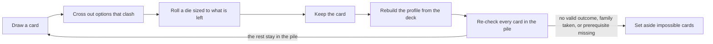

# Phonology Challenge: card expansion plan

As of 2026-11-04. Editable copy: [Claude Doc](https://claude.ai/artifact/6R1fk5PSq4ZNwtJ4TxJ9CR). This file is the repo snapshot of that doc; if they differ, ask which one is current.

## Where things stand

- **Built:** the roller in `phonology-challenge.html`, with all 57 hand-made cards, the parser (`[dN]`, `A+[dN]`, `[dN*K]`, lists, coin flips, `(If x: …)`), dice physics, the deck, and account or browser saving.
- **Phase 4, started early (profile-free part):** 12 phoneme mandate cards, the `[ipa:…]` pool syntax (feature terms joined with `+`), the bundled PHOIBLE 2.0 table (871 segments), a dealt hand of up to 20, and the phoneme name on the card. Kept cards store their phonemes in `entry.phonemes` for the profile to read later. Not done yet: filtering pools against the profile and the feature write-back, which wait on Phase 3.
- **Not started:** everything else below. **Next step: Phase 1** (card fixes and families), unless phoneme cards continue first.
- **Unanswered question from the doc:** should the new vowel height list use all seven IPA heights, or a simpler high/mid/low split?

## Summary

The roller gets a **language profile**: a running record of what your kept cards have committed the language to. The profile does three jobs. It removes impossible cards from the pile, it crosses out options that would contradict earlier cards, and it makes phoneme cards possible.

Around that core, the plan adds six new card types, fills coverage gaps in the current 57 cards, and fixes cards whose wording or dice don't work. Work is split into six phases, and the first one needs no profile at all.

## Decisions made

**Clashing options are crossed out, and the die rolls only what's left.** Before a roll, every option that contradicts the profile is struck through on the option strip. The remaining options are renumbered, and the tray offers a die with that many sides. For example, a d12 place roll with 3 places ruled out becomes a d9 over the 9 places still open.

- **Number rolls** shrink the same way. If the inventory budget leaves room for only 6 more rare phonemes, a d10 rolls as a d6.
- **Coin flips** with one side crossed out are decided without a flip. The card shows the forced result and why.
- **A slot with nothing left** can't happen in play, because the pile filter (below) sets such cards aside before they can be drawn.

**Clashes filter the pile.** After every keep, the tool re-checks each card in the pile. A card leaves the pile when no outcome of it fits the profile, when a card from its family is already in the deck, or when its prerequisite is missing. Set-aside cards stay visible in a small "set aside" list with the reason for each, and they return automatically if you remove the card that blocked them.

## The language profile

The profile is rebuilt from the deck every time the deck changes, so removing a kept card also removes the facts it added. Each card writes to one or more areas:

| Area | What it records | Written by (examples) |
| --- | --- | --- |
| Inventory size | Consonant and vowel count ranges, diphthong count, open cells | Consonant Count Small/Medium/Large, Vowel Count, Diphthong Count, Open cells |
| Places | Included, excluded, neutralized, symmetrical; minor and major place totals | Include place, Place neutralization, Place limitations, Total minor/major places |
| Manners | Included, excluded, neutralized, symmetrical | Include manner, Manner neutralization, Manner limitations |
| Special series | Airstream (ejective, implosive, click), laryngeal (aspirated, breathy), secondary articulation, prenasalization | Include special, Special limitations |
| Vowel space | Heights, backness and rounding included or excluded | Include vowel position, Vowel position limitation and symmetry |
| Vowel features | Nasality, phonation, length, tone | Include vowel feature, Total vowel features |
| Prosody | Quantity yes or no, tone yes or no, stress system, foot type and direction, pitch accent | Quantity distinction, Pitch accent, Foot type, Quantity sensitivity |
| Syllables | Moras per syllable, structure limits | Mora per syllable, Syllable/Foot/Word limitations |
| Mandated phonemes | Each phoneme with its full feature set | New phoneme cards |
| Phoneme budget | How many phonemes are already spoken for by frequency band | Common, Uncommon and Rare phonemes cards |

Four kinds of clash are checked against these areas:

1. **Contradiction.** One card includes something another excludes. Example: "Don't include velar" against "neutralization of velar".
2. **Budget.** Required phonemes exceed the inventory size. Example: 15 rare plus 20 common phonemes in a 5+d15 consonant inventory.
3. **Dependency.** A card needs something that isn't there. Example: tone sandhi without tone, or quantity sensitivity after "Don't include any sort of quantity distinction".
4. **Family.** Only one card per family. Example: one consonant count card per set.



The profile is checked twice: once on the whole pile after each keep, and again on each slot just before its roll.

## Phoneme mandate cards

These cards require specific phonemes, such as "Include a rare phoneme" or "Include a co-articulated stop". Each phoneme is classified by **articulatory features**, the same terms the IPA chart and your current cards use. Acoustic classes like strident or grave wouldn't line up with what the cards say.

**Features per phoneme**

- Consonants: place, manner, voicing and phonation, airstream (pulmonic, ejective, implosive, click), secondary articulation, laterality, sibilance, length. Co-articulated stops such as k͡p and ŋ͡m carry two places.
- Vowels: height, backness, rounding, nasality, phonation, length.

**Data source.** [PHOIBLE](https://phoible.org) 2.0 lists segments from 3,020 inventories covering 2,185 languages. Its frequency bands match your existing thresholds: 6% or more is common, 1% or less is rare, and everything in between is uncommon (so the 14 segments between 5% and 6% count as uncommon, though the Uncommon phonemes card says "5% or less"). Frequency is the share of languages (distinct Glottocodes) that have a segment.

As built: the page ships only symbols and language counts (about 5 KB). Features come from reading the IPA symbol itself (`describePhoneme`), so the terms match the IPA chart and your cards. `scripts/build-phonemes.js` regenerates the table from the PHOIBLE CSV. It drops tones, diphthongs, merged `a|b` segments and anything found in fewer than 3 languages, which leaves 871 segments (93 common, 200 uncommon, 578 rare). PHOIBLE data is licensed **CC BY 4.0** (not CC BY-SA), and the page credits it under the deck.

**How a phoneme roll works**

1. The card names a pool, for example `[ipa:rare]` or `[ipa:coarticulated]`.
2. The tool filters the pool against the profile. A phoneme drops out if its place, manner, series or vowel position is excluded, or if the inventory budget is full.
3. Pools are often larger than any die, so the tool deals a hand of up to 20 candidates from the filtered pool onto the strip. Clashing candidates never make the hand.
4. You roll a die sized to the hand. The phoneme lands on the card.
5. Keeping the card writes the phoneme's features into the profile. A mandated /ʈ/ adds retroflex to included places and plosive to included manners, and counts toward the consonant total and the rare-phoneme count.

## New card types

Six types join the current constraint cards and the phoneme cards above.

| Type | What it does | Example | Needs the profile |
| --- | --- | --- | --- |
| Family | Groups cards so only one per family can be in a set | Consonant Count Small, Medium and Large | No |
| Prerequisite | Stays out of the pile until something it depends on is in the deck | Tone sandhi needs tone; extrametricality needs a foot-based stress system | Yes |
| Gap | Leaves one expected cell of the inventory empty | "Leave out the [voiced/voiceless] [place] [manner]", like a language with no /p/ | Yes |
| Template | Sets a concrete structure instead of a count | "Maximum syllable: C(d3)VC(d3)"; "Resolve hiatus by [deletion/epenthesis/glide formation/coalescence]" | Partly |
| Rule interaction | Asks for a specific relationship between rules | "Include a [feeding/bleeding/counterfeeding/counterbleeding] interaction"; "Include a chain shift" | No |
| Modifier | Changes other cards instead of the language | "Re-roll one die on a kept card"; "Flip a do/don't"; "Your next pick is your choice" | Yes, to re-check after the change |

## Gaps in the current cards

The 57 cards cover places, manners, counts and metrical stress well. These areas have no cards yet:

- **Low vowels.** No card can produce an open or open-mid vowel (see Fixes).
- **Rounding.** No card asks for front rounded or back unrounded vowels. Only vowel harmony mentions roundness.
- **Airstream.** Ejectives are the only non-pulmonic series. Implosives and clicks never come up.
- **Tone as its own category.** Nothing sets the number of tones, level versus contour tones, or the choice between tone, pitch accent and stress.
- **Common processes.** Lenition, fortition, final devoicing, palatalization, unstressed vowel reduction and compensatory lengthening are missing.
- **Syllable templates.** The limitation cards set a count of limits but never a concrete shape, onset or coda cluster, or sonority rule.
- **Morphology-linked phonology.** Reduplication, ablaut and morphologically conditioned alternations are missing. Consonant mutation and vowel harmony cover part of this.

## Fixes to existing cards

These are changes to your card list, not to the tool. The clash checks depend on the first four.

| Card(s) | Problem | Suggested fix |
| --- | --- | --- |
| All 3 vowel position cards | "High" and "close" name the same height, as do "mid-high" and "mid-close". There is no low or open option, and height and backness share one list. | Split into a height list [close/near-close/close-mid/mid/open-mid/near-open/open] and a backness list [front/central/back]. |
| Place, Manner, Special and Vowel position limitations | They print the same sentence as the inclusion cards, e.g. "Include 3 labiodental". | Reword as a ceiling: "Allow at most [d3] [place] consonants". |
| Include special | The list mixes airstream, laryngeal, secondary articulation and manner. | Keep the card, but tag each option with its feature type so clashes can be checked. |
| Include manner category | Peripheral, coronal, apical and laminal are place categories. | Rename it "Include place category". |
| Total major places | Most frameworks have about 5 major places, so 6 to 8 can't be met. | Use a d5. |
| Final constraint | A d6 against 5 options. | Add a sixth option (for example nasals) or use a d5. |
| Phoneme neutralization | `[10]` is fixed, so there is nothing to roll. | Use `[d10]` if a roll was intended. |
| Tone Allophones | Filed under Vowel Realizations, though tone is suprasegmental. | Move it to a new Tone category with a prerequisite on tone. |
| Mora per syllable | "Don't allow 3 moras" doesn't say whether 3 is the ceiling. | Reword as "Allow at most [d4] moras per syllable". |
| Non-Vocalic Nucelus | Typo. | "Nucleus". |

## Card-table syntax changes

Your spreadsheet format stays the same. Three additions let the tool understand what a card means, not just what it says.

**Named lists.** Each shared list is defined once and referenced by name. The name tells the tool which profile area a roll writes to.

```
@place    bilabial/labiodental/dental/alveolar/postalveolar/retroflex/palatal/velar/dorsal/uvular/pharyngeal/glottal
@manner   plosive/nasal/trill/tap/fricative/approximant/lateral/affricate
@vheight  close/near-close/close-mid/mid/open-mid/near-open/open
```

**Phoneme pools.** `[ipa:rare]`, `[ipa:uncommon]`, `[ipa:common]`, `[ipa:coarticulated]`, or a feature pool such as `[ipa:ejective]`.

**A tags column** at the end of the row, written as `key=value` pairs separated by semicolons:

| Tag | Meaning | Example |
| --- | --- | --- |
| `family` | Only one card with this family per set | `family=consonant-count` |
| `needs` | Prerequisite that must be in the profile | `needs=tone` |
| `effect` | How the roll writes to the profile: include, exclude, neutralize, at-most, symmetric, count | `effect=neutralize` |
| `counts` | Which total a number roll sets | `counts=consonants` |

Two rows in the new format (columns are tab-separated):

```
Consonant Inventory	Place neutralization		Include	the neutralization of	[d12] [@place]		effect=neutralize
Consonant Inventory	Consonant Count Small		Include	5+[d15] consonants		family=consonant-count; counts=consonants
```

Rows without tags still work, so your list can be upgraded a little at a time. Untagged cards are drawn as they are today, without clash checks.

## Build phases

Each phase ships on its own and leaves the roller usable.

1. **Card fixes and families.** Apply the fixes table to the card list. Add `family=` tags, and remove a card's siblings from the pile when it is kept. No profile is needed yet.
2. **Syntax.** Add named lists, the tags column and phoneme-pool syntax to the parser. The Edit cards preview shows each card's tags and flags unknown ones.
3. **Profile and clash checks.** Build the profile from the deck. Add the four clash kinds, pile filtering with the "set aside" list, crossed-out options and shrinking dice. Show the profile as a panel beside the deck.
4. **Phoneme cards.** Bundle the trimmed PHOIBLE table, add the phoneme pools, the dealt hand of candidates and the feature write-back.
5. **New constraint types.** Add prerequisite, gap, template and rule-interaction cards, plus new cards for the coverage gaps.
6. **Modifier cards.** Add cards that act on the deck, with a re-check of the profile after each change.

## Open questions

- [ ] A do/don't card where one side is crossed out has a forced result. Should it stay in the pile, or be set aside as a dud?
- [ ] For phoneme pools, is a dealt hand of 20 right, or would a two-stage roll (class first, then phoneme) feel better?
- [ ] Should a challenge set have a fixed size, for example 12 cards with a target mix per category?
- [ ] Which option should replace the sixth face of Final constraint, or should it become a d5?
- [ ] Should the new vowel height list use all seven IPA heights, or a simpler high/mid/low split?
